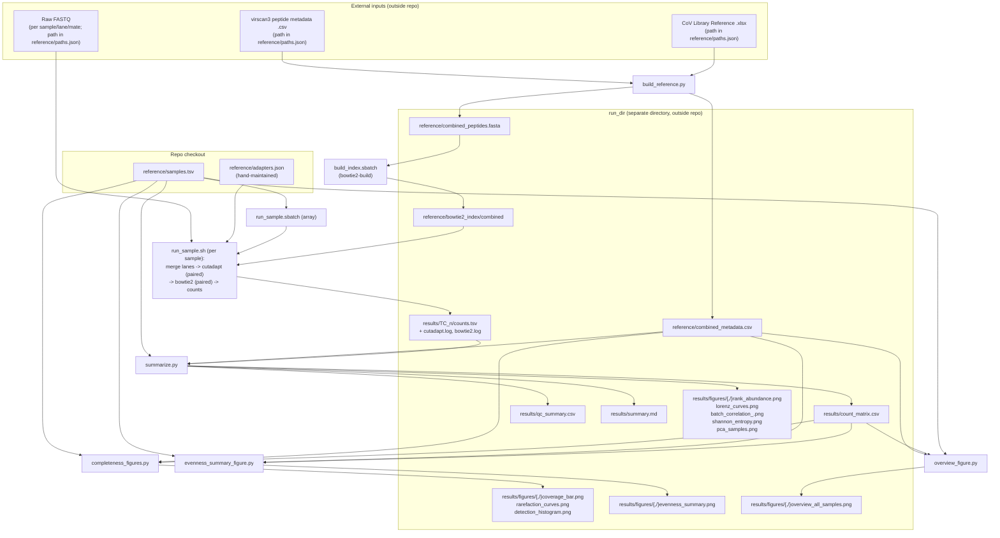

# PhIP-seq Phage Library QC Pipeline

## Overview

This repository is a QC pipeline for two in-house-grown T7 phage-display
libraries ("T7CoV" and "T7 Vir3.2/VirScan3") sequenced **before any
selection** (naive/input pools). It answers a single question per grown
batch: after cloning and growing the designed peptide library, how much of
the designed peptide set survived, and how evenly represented is it
(dropouts, jackpotting/over-representation, batch-to-batch reproducibility)?

Six sequenced batches ("samples") are processed:
- `TC_1`–`TC_4`: T7CoV library (SARS-CoV-2 + related coronavirus peptide
  tiles)
- `TC_5`–`TC_6`: T7 Vir3.2/VirScan3 library (pan-viral peptide tiles)

For each sample, paired-end reads (both sequencing lanes merged first) are
trimmed to the constant vector adapter and aligned as read pairs against a
combined reference built from both libraries' designed peptide sets, then
counted per peptide. Counts are then aggregated into a peptide-by-sample
matrix plus QC figures/report (coverage, dropouts, evenness, cross-library
mapping, batch correlation).

This pipeline was migrated from a local, macOS-only, single-end-per-mate
design to a SLURM-scheduled HPC deployment; see
[slurm_plan.md](slurm_plan.md) for the full design rationale (lane merging,
paired-end alignment, config consolidation, retired scripts, resource
requests) behind the current script behavior described below.

**The repo checkout and the pipeline's run output are separate directories.**
All generated reference data (`combined_peptides.fasta`, `combined_metadata.csv`,
the bowtie2 index) and all `results/` output are written to a `run_dir`
configured in `reference/paths.json`, not into the repo checkout itself —
see [Configuration](#configuration). This keeps the repo free of large/
per-run generated content; only hand-maintained config, scripts, and the
sample sheet live in the repo.

**Results in this repository predate the migration.** The `results/` and
`reference/{combined_peptides.fasta,combined_metadata.csv,bowtie2_index/}`
currently checked into this repo are output from the old single-end,
per-lane, run-in-place pipeline (e.g. `R1_counts.tsv`/`R2_counts.tsv`,
`count_matrix_R1.csv`/`count_matrix_R2.csv`) for `TC_1`–`TC_4` only. That
output does not match the current scripts' paired-end output shape
(`counts.tsv`, `count_matrix.csv` — see
[Script running order](#script-running-order)), nor the current
repo-vs-run_dir split, and needs to be regenerated from scratch in a real
`run_dir` once the real HPC input paths (see
[Configuration](#configuration)) are filled in.

## Repository structure

```
PhIPseq/
├── environment.yml                # conda env spec (Python packages only)
├── slurm_plan.md                  # SLURM/HPC migration design notes
├── scripts/
│   ├── build_reference.py         # parses source library references -> combined FASTA + metadata (written to run_dir)
│   ├── setup_env.sh               # builds/updates the "phipseq" conda env from environment.yml
│   ├── run_sample.sh              # per-sample: merge lanes -> cutadapt (paired) -> bowtie2 (paired) -> counts (written to run_dir)
│   ├── run_sample.sbatch          # SLURM array job wrapping run_sample.sh, one task per sample
│   ├── build_index.sbatch         # SLURM job: bowtie2-build the combined index (written to run_dir)
│   ├── summarize.sbatch           # SLURM job: summarize.py + the four figure/table scripts
│   ├── differential.sbatch        # SLURM job: differential_enrichment.py (runs after summarize)
│   ├── summarize.py               # count matrix + qc_summary.csv + core figures + summary.md (written to run_dir)
│   ├── completeness_figures.py    # coverage / rarefaction / detection-histogram figures
│   ├── evenness_summary_figure.py # per-sample evenness figure
│   ├── overview_figure.py         # combined coverage+evenness overview figure
│   ├── top_peptides.py            # top-N most variable peptides heatmap + top-N most abundant peptides tables
│   ├── differential_enrichment.py # DESeq2-style enrichment vs the background library, per IP
│   ├── sample_groups.py           # shared: sample sheet + metadata merge, treatment colours, all/per-IP figure groups
│   └── count_filters.py           # shared: low-count coverage threshold + count-matrix row filter
├── reference/                     # hand-maintained config, tracked in the repo
│   ├── paths.json                 # external file locations + run_dir -- placeholders
│   ├── run_params.json            # LANES, BOWTIE_THREADS, CUTADAPT_THREADS
│   ├── build_reference_params.json# vector anchor sequences, minimum Vir3 insert length
│   ├── figure_params.json         # outlier threshold, legend/tick layout, PCA size, optional treatment_colors
│   ├── filter_params.json         # low-count filtering thresholds (coverage threshold, matrix filter)
│   ├── de_params.json             # differential enrichment: reference treatment, alpha, LFC threshold
│   ├── hpc_modules.json           # pinned cutadapt/bowtie2/samtools HPC module versions
│   ├── adapters.json              # per-library R1/R2 constant adapter sequences (hand-maintained)
│   ├── samples.tsv                # sample sheet: tc_id, library, sample_prefix
│   └── samples_meta.csv           # per-sample metadata: sample, ip, treatment (required by the figure scripts)
├── <run_dir>/                     # separate directory, path set in reference/paths.json -- NOT part of this repo
│   ├── reference/
│   │   ├── combined_peptides.fasta   # generated by build_reference.py
│   │   ├── combined_metadata.csv     # generated by build_reference.py
│   │   └── bowtie2_index/            # generated by build_index.sbatch
│   └── results/
│       ├── <tc_id>/                  # per-sample counts.tsv, cutadapt.log, bowtie2.log
│       ├── count_matrix.csv, qc_summary.csv, summary.md
│       ├── count_matrix_filtered.csv, filter_report.csv
│       ├── differential/             # differential enrichment results, figures and summary.md
│       ├── top_abundant_peptides.csv, top_abundant_peptides_wide.csv
│       └── figures/                  # PNG figures, all samples
│           └── <ip>/                 # same figures, one folder per IP condition (IP4/, IP5/)
├── results/                        # PRE-MIGRATION output, checked into the repo -- see note above; not written to by current scripts
│   ├── TC_1..TC_4/                 # per-sample logs + counts, from the old pipeline
│   ├── count_matrix_R1.csv, count_matrix_R2.csv
│   ├── qc_summary.csv, summary.md, figures/
│   ├── coding_plan.md              # human-authored planning notes (project background, design rationale)
│   └── *.run.log, run_*.log
└── .gitignore
```

## Environment & dependencies

**Python** — `environment.yml` at the repo root defines a conda env named
`phipseq` (build/update it with `scripts/setup_env.sh`):
- `python` (unpinned — always resolves the current stable conda-forge
  release)
- `pandas>=2.2`, `numpy>=2.1`, `matplotlib>=3.9`, `scipy>=1.14`,
  `openpyxl>=3.1` (pandas's `.xlsx` engine for `build_reference.py`),
  `tabulate>=0.9` (pandas's markdown-table engine, for
  `summarize.py`'s `qc.to_markdown()` call)

These floors are recommended current-stable versions, not confirmed against
what the pre-migration `results/` were generated with (no version pins
existed anywhere in the repo before this migration).

**Command-line tools** — provided by the HPC's module system, not conda;
exact versions are pinned in `reference/hpc_modules.json` and loaded via
`module load` at the top of every `.sbatch` script:
- `cutadapt` (`cutadapt/4.2-GCCcore-11.3.0`) — paired-mode adapter trimming
  (`run_sample.sh`)
- `bowtie2` (`Bowtie2/2.5.4-GCC-14.2.0`) — paired-end alignment
  (`run_sample.sh`); `bowtie2-build` (same module) builds the index
  (`build_index.sbatch`)
- `samtools` (`SAMtools/1.22.1-GCC-14.2.0`) — read filtering/counting
  (`run_sample.sh`)

No `.venv` is used anymore — `run_sample.sh`'s config-loading step needs
only a `python3` with the standard library `json` module on `PATH` (the
activated `phipseq` conda env satisfies this).

## Configuration

Paths, tunables, and library-design constants that used to be hardcoded
Python/shell constants now live in JSON under `reference/` (in the repo
checkout):

- **`reference/paths.json`** — FASTQ directory (`run_sample.sh`), the two
  source reference files (`build_reference.py`), and **`run_dir`**: the
  directory (outside this repo) where generated reference data and
  `results/` are written by every script. **Ships with placeholder
  values** — the real HPC paths (including `run_dir`) need to be filled in
  before the pipeline can actually run (see [Overview](#overview)).
- **`reference/run_params.json`** — `lanes` (`["L007", "L008"]`),
  `bowtie_threads`, `cutadapt_threads`. (There is no `max_parallel`/retry
  config — SLURM's own array scheduling and job-failure handling took over
  both roles; see [slurm_plan.md](slurm_plan.md).)
- **`reference/build_reference_params.json`** — CoV/Vir3 vector anchor
  sequences and the minimum Vir3 insert length, consumed by
  `build_reference.py`.
- **`reference/figure_params.json`** — figure tunables shared by all four
  figure scripts: `outlier_threshold`, `legend_bbox_anchor`,
  `xtick_rotation`, `heatmap_tick_fontsize`, `detection_histogram_ncols`,
  `pca_n_top_variable_peptides`, `heatmap_n_top_variable_peptides`
  (default `100`), `top_abundant_n_peptides` (default `20`), and an
  optional `treatment_colors`
  object (`{"<treatment>": "<matplotlib colour>"}`) overriding individual
  entries of the default treatment palette.
- **`reference/hpc_modules.json`** — exact `cutadapt`/`bowtie2`/`samtools`
  module versions; the single source of truth every `.sbatch` script's
  `module load` line should match.
- **`reference/adapters.json`** — per-library (`CoV`, `Vir3`) R1/R2 constant
  adapter sequences, consumed by `run_sample.sh` as the `cutadapt -g`/`-G`
  arguments. **Hand-maintained** — there is no script that (re)derives these
  anymore.
- **`reference/samples.tsv`** — tab-separated sample sheet, columns `tc_id`,
  `library` (`CoV` or `Vir3`), `sample_prefix`. Drives `run_sample.sbatch`'s
  array-task-to-sample lookup and which columns appear in the aggregation
  scripts' outputs. `summarize.py`, `completeness_figures.py`,
  `evenness_summary_figure.py`, and `overview_figure.py` all accept an
  alternate sample sheet as an optional first CLI argument, e.g. to produce
  outputs from a subset of samples — `run_sample.sbatch` always uses
  `reference/samples.tsv` itself, though.
- **`reference/samples_meta.csv`** — per-sample metadata, columns
  `sample` (matching `tc_id`), `ip`, `treatment`. **Required** by all four
  aggregation/figure scripts (overridable as their second CLI argument);
  they exit with an error naming any `samples.tsv` sample missing an
  `ip`/`treatment`. Rows for samples not in `samples.tsv` are ignored.

- **`reference/filter_params.json`** — low-count filtering, see
  [Low-count filtering](#low-count-filtering): `coverage_min_count`
  (default `10`), `matrix_filter_min_count` (default `10`),
  `matrix_filter_min_samples` (default `2`).

### Low-count filtering

`scripts/count_filters.py` applies two deliberately separate filters:

- **Coverage threshold (`coverage_min_count`)** — for library-completeness
  metrics a peptide counts as detected only with >= this many reads. It is
  reported *alongside* the >=1-read metrics, never instead of them:
  `n_peptides_detected_min10` / `pct_library_covered_min10` in
  `qc_summary.csv`, solid (>=10) over light (>=1) bars in `coverage_bar.png`
  and `overview_all_samples.png`, `rarefaction_curves_min10.png` (binomial
  thinning approximation), and a shaded 1-9-read band in
  `detection_histogram.png`. The count matrix is not changed and the
  denominator is always the full designed library.
- **Matrix filter (`matrix_filter_min_count` in >= `matrix_filter_min_samples`
  samples)** — whole peptides (rows) failing it are dropped, so there are
  no NAs; `min_samples = 2` matches the replicate count, so a peptide
  consistently seen in one condition's replicates is kept without needing
  group labels. Written to `count_matrix_filtered.csv` (per-sample reads
  removed in `filter_report.csv`) — the shareable filtered matrix, also
  used for the top-abundant-peptide tables (whose CPM still uses each
  sample's raw read total). The between-sample figures — PCA, batch
  correlation and the top-variable heatmap — instead apply the same
  thresholds **within each figure group** (`passes_filter` on just that
  group's samples), so e.g. the IP4 figures only use peptides with >= 10
  reads in >= 2 IP4 samples (74,908 here), not ones kept because of IP5. It is never used for coverage — the
  dropped rows are by definition the undetected ones, so coverage over the
  kept rows would be inflated.
- Rank-abundance, Lorenz, Shannon entropy and evenness still use the raw
  matrix (evenness already calls out <=10-read peptides explicitly via
  `outlier_threshold`).

### Differential enrichment

`scripts/differential_enrichment.py` (run by `scripts/differential.sbatch`,
after `summarize.sbatch` has written `count_matrix.csv`) tests which
peptides are enriched over the background library, **separately within each
IP**. Thresholds live in `reference/de_params.json`.

- **Model** — one DESeq2-style negative-binomial fit per contrast
  (PyDESeq2): every non-reference treatment, including the `Phage & beads`
  mock IP, against `reference_treatment` (`Vir3 only`) among that IP's
  samples. Two-sided Wald test, BH-adjusted p-values with DESeq2
  independent filtering. **Enriched** = `padj < alpha` and
  `log2FoldChange > lfc_threshold`.
- **Per contrast, not per IP.** Fitting all of an IP's samples in one model
  shares dispersion across more samples, but then admits peptides absent
  from the 2 reference samples entirely (they pass the per-IP filter on
  other treatments). Those have no finite fold-change estimate — PyDESeq2
  returns its optimiser bound, ±30/ln2 = ±43.28 — which broke apeGLM
  shrinkage globally and let 2–8 CPM noise reach `padj ~1e-17`, outranking
  the real signal. Fitting per contrast removes the unbounded estimates and
  puts the expected hits on top (see below).
- **Size factors**: `poscounts`, since the default median-of-ratios needs
  peptides counted in every sample (only 47 in IP4).
- **LFC shrinkage is off** (`shrink_lfc: false`): PyDESeq2's apeGLM proved
  unstable here — for some peptides the shrunken value collapsed to ~0.3
  while the raw LFC was 13–14. Raw `log2FoldChange` is reported and
  plotted.
- **Calibration check** — `frac_p_below_alpha` per contrast should sit near
  `alpha` under the null. IP4's contrasts run at 0.22–0.26, so its
  p-values are anti-conservative and its hit counts are upper bounds;
  this matches IP4's poor replicate correlation (r = 0.01–0.16). Affected
  contrasts are flagged in red in the volcano titles and called out in
  `differential/summary.md`.
- **Positive control** — IP4 `12CA5 2ug` (an anti-HA-tag antibody) returns
  influenza hemagglutinin peptides as its top hits, which is the expected
  result and a check that normalisation and the contrast setup are right.

### Figure groups and colouring

`scripts/sample_groups.py` (imported by all four figure-generating
scripts) defines how every figure is drawn:

- **Groups** — each figure is drawn once for all samples
  (`<run_dir>/results/figures/`) and once per IP condition
  (`<run_dir>/results/figures/<ip>/`, e.g. `IP4/`, `IP5/`), with the same
  file names in each folder and the group in each figure title.
- **Colour = treatment**, fixed across every figure and group (so IP4 and
  IP5 figures are directly comparable): `tab20` in order of first
  appearance in `samples_meta.csv`, with optional overrides from
  `figure_params.json`'s `treatment_colors`.
- **Line style / marker = ip** in the all-samples figures (ticks are
  prefixed with the ip too), **= replicate** (1, 2, ... within ip +
  treatment, in `samples.tsv` order) in the per-IP figures.
- **Sample order** — by ip, then treatment (`samples_meta.csv` order), then
  `samples.tsv` order, so replicates sit side by side. This is also the
  column/row order of `count_matrix.csv` and `qc_summary.csv`.
- Near-dropout markers are black and the "never detected" histogram bin
  dark gray, to stay distinct from the treatment palette.
- The PCA is **computed separately for each group** (all samples, each
  IP): log10(CPM + 1), CPM scaled by each sample's raw read total, over the
  peptides with >= `matrix_filter_min_count` reads in >=
  `matrix_filter_min_samples` of *that group's* samples (zeros allowed),
  top `pca_n_top_variable_peptides` by variance. Each plot has its own
  axes, so positions are not comparable between groups; scores (PC1-PC5)
  are written to `pca_scores.csv` in each figures folder.

Every Python script and `run_sample.sh` reads `reference/paths.json`
relative to the repo checkout (via `Path(__file__).resolve().parent.parent`),
then resolves `run_dir` from it and writes/reads all generated data there —
so the repo location and the run_dir location can be completely unrelated
directories.

## Usage

Run from the repository root (`PROJECT_DIR` in the scripts resolves to the
parent of `scripts/`).

**Before submitting any `.sbatch` script**, export `PHIPSEQ_REPO_DIR` to
the repo checkout's path, once per shell session:
```bash
export PHIPSEQ_REPO_DIR=/path/to/PhIPseq
```
This is required — SLURM copies a submitted script into a per-job spool
directory on the compute node and runs *that* copy, so a script can't find
its own repo checkout via its own file location (`${BASH_SOURCE[0]}`) the
way a plain bash script normally would. All three `.sbatch` scripts fail
fast with a clear error if `PHIPSEQ_REPO_DIR` is unset.

1. **Build the conda env** (once, or whenever `environment.yml` changes):
   ```bash
   bash scripts/setup_env.sh
   ```
2. **Fill in real paths** in `reference/paths.json` — FASTQ directory, CoV
   `.xlsx`/Vir3 `.csv` source files, and `run_dir` (a directory outside this
   repo where all generated reference data and `results/` will be written).
   These ship as placeholders.
3. **Build the combined reference**:
   ```bash
   conda activate phipseq
   python scripts/build_reference.py
   ```
   → `<run_dir>/reference/combined_peptides.fasta`,
   `<run_dir>/reference/combined_metadata.csv`
4. **Build the bowtie2 index**:
   ```bash
   sbatch scripts/build_index.sbatch
   ```
   → `<run_dir>/reference/bowtie2_index/combined`
5. **Confirm `reference/adapters.json`** has correct R1/R2 adapters for both
   libraries (hand-maintained, no script generates it).
6. **Trim/align/count all samples** (SLURM array job, one task per row of
   `reference/samples.tsv`):
   ```bash
   sbatch scripts/run_sample.sbatch
   ```
   For local/dev use without SLURM, `run_sample.sh` can be invoked directly
   per sample instead (requires `cutadapt`/`bowtie2`/`samtools` on `PATH`
   and the `phipseq` conda env activated) — there is no batch driver for
   this anymore, so each sample needs its own invocation. This does *not*
   need `PHIPSEQ_REPO_DIR` set, since it's plain bash execution, not a
   SLURM submission — `run_sample.sh` resolves its own location normally:
   ```bash
   bash scripts/run_sample.sh TC_1 CoV CAY9116A7_S70
   ```
7. **Aggregate counts + QC report**, once all samples have finished
   (submit with a dependency on the array job's job ID):
   ```bash
   sbatch --dependency=afterok:<run_sample_job_id> scripts/summarize.sbatch
   ```
   which runs, in order: `summarize.py`, `completeness_figures.py`,
   `evenness_summary_figure.py`, `overview_figure.py` — the latter three
   accept an optional first positional argument to point at a different
   sample sheet (e.g. a custom TSV covering only a subset of samples,
   following `reference/samples.tsv`'s schema). All output lands in
   `<run_dir>/results/`.

Raw FASTQ input and the two source library reference files (CoV `.xlsx` and
VirScan3 `.csv`) live outside this repository on lab-internal storage; their
paths, along with `run_dir`, are configured in `reference/paths.json`
(currently placeholders, not reproduced here).

None of the `.sbatch` scripts set a static `--output` for SLURM's own
job-log capture, since it would otherwise have to reference a `results/`
path relative to the repo that no longer matches where output actually
goes — pass `--output=<run_dir>/...` explicitly at submission time, or
submit from within `run_dir`, if you want to control where that lands.

## Script running order

Confirmed from actual code paths (inputs/outputs, `subprocess`/shell calls),
not from filename order:

1. `build_reference.py` — reads only external source files (per
   `reference/paths.json`); independent of every other step.
2. `build_index.sbatch` (`bowtie2-build`) — requires
   `<run_dir>/reference/combined_peptides.fasta` from step 1.
3. `reference/adapters.json` — hand-maintained, no script dependency.
4. `run_sample.sbatch` (array job) — each task calls `run_sample.sh` once
   per sample row of `reference/samples.tsv`; requires
   `reference/adapters.json` (step 3) and
   `<run_dir>/reference/bowtie2_index/combined` (step 2) to exist. Samples
   are independent of each other, and SLURM's array scheduling runs them
   unthrottled/concurrently.
5. `summarize.py` — requires `<run_dir>/results/<tc_id>/counts.tsv`,
   `<run_dir>/results/<tc_id>/cutadapt.log`,
   `<run_dir>/results/<tc_id>/bowtie2.log` for every sample in its sample
   sheet (from step 4), and `<run_dir>/reference/combined_metadata.csv`
   (from step 1).
6. `completeness_figures.py`, `evenness_summary_figure.py`,
   `overview_figure.py` — each requires `<run_dir>/results/count_matrix.csv`
   (written by `summarize.py`, step 5) and
   `<run_dir>/reference/combined_metadata.csv`. These three do not depend on
   each other and can run in any order (bundled sequentially in
   `summarize.sbatch` for simplicity).

All six steps resolve `<run_dir>` from `reference/paths.json` in the repo
checkout at runtime — nothing about this order changes based on where the
repo checkout itself lives.

## How it fits together / data flow



## Shared inputs/outputs

- **`reference/adapters.json`** (repo) — hand-maintained; consumed only by
  `run_sample.sh` (paired `cutadapt -g`/`-G` arguments).
- **`<run_dir>/reference/combined_metadata.csv`** — produced by
  `build_reference.py`; consumed by `summarize.py`,
  `completeness_figures.py`, `evenness_summary_figure.py`,
  `overview_figure.py` (all four map `ref_id` -> `library`/organism/protein
  via this file).
- **`<run_dir>/reference/combined_peptides.fasta`** — produced by
  `build_reference.py`; consumed only by `build_index.sbatch`
  (`bowtie2-build`).
- **`<run_dir>/reference/bowtie2_index/combined`** — produced by
  `build_index.sbatch`; consumed only by `run_sample.sh` (bowtie2 `-x`
  argument).
- **`reference/samples.tsv`** (repo) — read by `run_sample.sbatch` (always)
  and by `summarize.py`, `completeness_figures.py`,
  `evenness_summary_figure.py`, `overview_figure.py` (default, overridable
  via first CLI argument).
- **`reference/samples_meta.csv`** (repo) — read (required) by
  `summarize.py`, `completeness_figures.py`, `evenness_summary_figure.py`,
  `overview_figure.py` via `sample_groups.py` (default, overridable via
  second CLI argument).
- **`<run_dir>/results/<tc_id>/counts.tsv`** — one paired-end fragment count
  per peptide, produced per sample by `run_sample.sh`; consumed only by
  `summarize.py`.
- **`<run_dir>/results/<tc_id>/cutadapt.log`, `bowtie2.log`** — one of each
  per sample, produced by `run_sample.sh`; parsed only by `summarize.py`
  (`parse_cutadapt_paired_log`, `parse_bowtie2_paired_log`) for QC
  read-pair statistics.
- **`<run_dir>/results/count_matrix.csv`** — produced by `summarize.py`;
  consumed by `completeness_figures.py`, `evenness_summary_figure.py`,
  `overview_figure.py`.
- **`reference/paths.json`** (repo) — read by every Python script and
  `run_sample.sh` to resolve `run_dir` before touching any generated data;
  the single place the repo-vs-run_dir split is configured.
- **`reference/hpc_modules.json`** (repo) — not read by any script; it's the
  source of truth every `.sbatch` script's `module load` line is kept in
  sync with by hand.

## Reference data

This pipeline does not use a public reference genome/annotation database;
the "reference" is the combined set of designed phage-display peptide
sequences from two source libraries, external to this repo:

- **T7CoV library** ("CoV" in `library` columns) — SARS-CoV-2 and related
  coronavirus peptide tiles (56mers), sourced from an external
  `CoV Library Reference.xlsx` (path configured in `reference/paths.json`,
  currently a placeholder). Per-clone barcode ID used as `source_id`; a
  separate `parent_peptide_id` groups synonymous barcode replicates
  (`BC1`/`BC2`/...).
- **T7 Vir3.2 / VirScan3 library** ("Vir3" in `library` columns) — pan-viral
  peptide tiles, sourced from an external `virscan3.peptide.metadata.csv`
  (path configured in `reference/paths.json`, currently a placeholder),
  combining three source provenances present in that file (`Vir2`, `Vir3`,
  `IEDB`) that share one physical synthesized oligo pool.
- No genome build, gene annotation version, or external sequence database
  (e.g. RefSeq/UniProt release) is referenced anywhere in the scripts;
  `organism`/`protein_name` fields in `<run_dir>/reference/combined_metadata.csv`
  are carried through as-is from the two source files without further
  annotation lookup.
- `<run_dir>/reference/combined_metadata.csv` columns: `ref_id`, `library`,
  `source_id`, `parent_peptide_id`, `organism`, `protein_name`,
  `peptide_aa`, `start`, `end`, `insert_len`.

## Compute requirements

SLURM-scheduled (see `scripts/*.sbatch`); resource requests agreed as part
of the migration (see [slurm_plan.md](slurm_plan.md) for the reasoning):

| Job | CPUs | Memory | Wall-clock | Notes |
|---|---|---|---|---|
| `run_sample.sbatch` | 4 | 32G | 7 days | Array job, `--array=1-6`, unthrottled (no `%N` — SLURM schedules all 6 tasks concurrently if resources allow). 7-day wall-clock requested flat since it has negligible queue-time impact on this cluster; `bowtie2 -p4`/`cutadapt -j2` run sequentially within a sample (trim, then align), so 4 CPUs covers the peak. |
| `build_index.sbatch` | 4 | 8G | 1 hour | One-off; `bowtie2-build` on the combined FASTA. |
| `summarize.sbatch` | 1 | 8G | 2 hours | Single-core matplotlib figure generation over an already-aggregated matrix; no alignment/trimming. |

No per-lane retry loop exists anymore (the pre-migration script retried
each lane 5 times / 20s backoff specifically to work around a macOS/SMB
`close()`/EBADF bug); a failed array task now surfaces as a nonzero exit in
`sacct`/`seff` and can be resubmitted individually or via `--requeue`.

None of the three `.sbatch` scripts set a static `--output` directive (see
[Usage](#usage)) — SLURM's own default job-log naming applies unless you
override it at submission time.

## Individual script details

### build_reference.py
- Purpose: parse the two source phage-display library reference files and
  emit one combined peptide FASTA + one combined metadata CSV with
  namespaced IDs.
- Inputs: `CoV Library Reference.xlsx` (path from `reference/paths.json`,
  currently a placeholder) — `Nucleotide sequence`, `Barcode ID`,
  `Peptide ID`, `Organsim` [sic], `Protein name`, `Peptide sequence`,
  `Start position`, `End position` columns; `virscan3.peptide.metadata.csv`
  (path from `reference/paths.json`, currently a placeholder) — `oligo`,
  `source`, `id`, `Organism`, `Protein.names`, `peptide`, `start`, `end`
  columns. Vector anchor sequences and the minimum Vir3 insert length come
  from `reference/build_reference_params.json`.
- Outputs: `<run_dir>/reference/combined_peptides.fasta` (downstream
  consumer: `build_index.sbatch`'s `bowtie2-build` only);
  `<run_dir>/reference/combined_metadata.csv` (downstream consumers:
  `summarize.py`, `completeness_figures.py`, `evenness_summary_figure.py`,
  `overview_figure.py`). `run_dir` comes from `reference/paths.json`.
- Key steps:
  - Load `reference/paths.json` and `reference/build_reference_params.json`
    from the repo checkout; resolve `run_dir` from the former.
  - Load the CoV `.xlsx` via `pandas.read_excel`.
  - For each CoV row, locate the fixed 5'/3' vector anchors in the
    nucleotide sequence and extract the peptide-coding insert between them.
  - Skip CoV rows missing either anchor or with an empty insert (counted
    and logged to stderr).
  - Load the Vir3 `.csv` via `csv.DictReader`.
  - For `source == "Vir2"` rows, extract the insert as the longest
    lowercase run in the (mixed-case-masked) oligo; for `Vir3`/`IEDB` rows,
    extract via fixed 5'/3' anchors (uppercase-only masking convention).
  - Skip Vir3 rows with an insert shorter than `min_vir3_insert_len`;
    collapse exact-duplicate rows sharing an `id`; disambiguate non-exact
    `id` collisions with a `.dupN` suffix.
  - Concatenate CoV + Vir3 records, de-duplicate by final `ref_id`
    (`CoV|<id>` / `Vir3|<id>`), and write one FASTA record and one metadata
    row per unique `ref_id` into `<run_dir>/reference/`.
  - Log parse/skip/duplicate counts to stderr.
- Key parameters: no CLI arguments; source paths, `run_dir`, and
  vector-anchor/min-insert constants come from `reference/paths.json` and
  `reference/build_reference_params.json` (see
  [Configuration](#configuration)).
- Dependencies: `pandas` (+ `openpyxl` engine for `.xlsx`), `csv`, `json`,
  `re`, `sys`, `pathlib` (stdlib).

### setup_env.sh
- Purpose: build or update the `phipseq` conda environment from
  `environment.yml`.
- Inputs: `environment.yml` (repo root).
- Outputs: the `phipseq` conda environment (not tracked in the repo).
- Key steps:
  - `conda env create -f environment.yml -n phipseq`, falling back to
    `conda env update` if the env already exists.
- Key parameters: none (no CLI arguments).
- Dependencies: `conda`.

### run_sample.sh
- Purpose: trim, align, and count one sample's paired-end reads (both
  lanes merged first, both mates trimmed/aligned together) against the
  combined bowtie2 index.
- Inputs: raw FASTQ for the given `sample_prefix`, both lanes, both mates
  (path from `reference/paths.json`); `reference/adapters.json`;
  `<run_dir>/reference/bowtie2_index/combined` (from `build_index.sbatch`);
  `reference/run_params.json` (lanes, thread counts). `run_dir` comes from
  `reference/paths.json`.
- Outputs: `<run_dir>/results/<tc_id>/counts.tsv` (one row per detected
  `ref_id`, tab-separated ref_id/count; downstream consumer:
  `summarize.py`); `<run_dir>/results/<tc_id>/cutadapt.log`, `bowtie2.log`
  (downstream consumer: `summarize.py`'s QC parsing).
- Key steps:
  - Create a fresh `mktemp -d` temp directory (honors `$TMPDIR` if set),
    cleaned up via `trap ... EXIT`.
  - Load `FASTQ_DIR`, `RUN_DIR`, thread counts, `LANES`, and the library's
    R1/R2 adapters from `reference/paths.json`, `reference/run_params.json`,
    and `reference/adapters.json` (all in the repo checkout) via one inline
    Python call.
  - Resolve `INDEX`/`OUT_DIR` under `RUN_DIR` and `mkdir -p` the sample's
    output directory.
  - Merge each mate's lanes into one file (`cat`-concatenating the raw
    `.gz` lane files, or `zcat | head | gzip` when subsampling) — a
    concatenated `.gz` is a valid multi-member gzip stream, so no
    decompress/recompress round-trip is needed for full-data runs.
  - Trim R1 and R2 together with one paired-mode `cutadapt` call
    (`-g`/`-G`, `--discard-untrimmed`), writing trimmed output to temp
    FASTQ files (`-o`/`-p`) rather than stdout, since paired `bowtie2`
    needs two separate, complete inputs.
  - Align the merged, trimmed mates jointly with paired-mode `bowtie2`
    (`-1`/`-2`, default `--fr` orientation, `--no-unal`).
  - Filter the resulting BAM to one record per aligned pair
    (`samtools view -F 4 -f 64`, first-in-pair) before extracting the
    reference ID (`cut -f3`) and counting (`sort | uniq -c`).
- Key parameters: positional args `tc_id`, `library` (`CoV`|`Vir3`),
  `sample_prefix`, optional `subsample_reads` (default `0` = full data; if
  >0, only the first N read pairs from the merged lanes are processed).
  `LANES`, `BOWTIE_THREADS`, `CUTADAPT_THREADS` come from
  `reference/run_params.json`; `RUN_DIR` from `reference/paths.json`.
- Dependencies: `cutadapt`, `bowtie2`, `samtools`, `zcat` (all via HPC
  modules pinned in `reference/hpc_modules.json`), plus a `python3` on
  `PATH` for the JSON config-loading step (the activated `phipseq` conda
  env satisfies this).

### run_sample.sbatch
- Purpose: SLURM array job wrapping `run_sample.sh` — the sole orchestration
  mechanism for running all samples (there is no local/non-SLURM batch
  driver in this repo; `run_sample.sh` can still be invoked directly for a
  single sample, see [Usage](#usage)).
- Inputs: `reference/samples.tsv` (row looked up via `SLURM_ARRAY_TASK_ID`);
  `reference/hpc_modules.json` (module versions, hardcoded in the header to
  match); the `PHIPSEQ_REPO_DIR` environment variable (see below).
- Outputs: SLURM's own default job-log capture (no static `--output`
  directive — see [Usage](#usage)); indirectly, everything `run_sample.sh`
  produces (in `<run_dir>/results/<tc_id>/`).
- Key steps:
  - Resolve `PROJECT_DIR` from the required `PHIPSEQ_REPO_DIR` environment
    variable (`${BASH_SOURCE[0]}` can't be used here — SLURM executes a
    copy of the submitted script from a per-job spool directory, not the
    original file, so the script's own location doesn't point back to the
    repo).
  - `module load` the pinned `cutadapt`/`bowtie2`/`samtools` versions.
  - Activate the `phipseq` conda env.
  - Look up this task's sample row (`SLURM_ARRAY_TASK_ID + 1`th line of
    `samples.tsv`, skipping the header).
  - Call `run_sample.sh <tc_id> <library> <sample_prefix>`.
- Key parameters: `--array=1-6` (unthrottled, no `%N`); `--cpus-per-task=4`,
  `--mem=32G`, `--time=7-00:00:00` (see [Compute
  requirements](#compute-requirements)); `PHIPSEQ_REPO_DIR` (required
  environment variable, not an `#SBATCH` option — see [Usage](#usage)).
- Dependencies: SLURM; `run_sample.sh`; the `phipseq` conda env.

### build_index.sbatch
- Purpose: build the combined bowtie2 index — a step no script performed
  before this migration (it was a manual/undocumented prerequisite).
- Inputs: `<run_dir>/reference/combined_peptides.fasta` (from
  `build_reference.py`); `run_dir` resolved from `reference/paths.json` via
  a `python3 -c` one-liner (this script has no other Python dependency, so
  it doesn't need the `phipseq` conda env active); the `PHIPSEQ_REPO_DIR`
  environment variable (see below).
- Outputs: `<run_dir>/reference/bowtie2_index/combined` (downstream
  consumer: `run_sample.sh`).
- Key steps:
  - Resolve `PROJECT_DIR` from the required `PHIPSEQ_REPO_DIR` environment
    variable (same reason as `run_sample.sbatch` — SLURM runs a spooled
    copy of the submitted script, not the original file).
  - Resolve `RUN_DIR` from `reference/paths.json` (found via `PROJECT_DIR`).
  - `module load` the pinned `bowtie2` version.
  - `mkdir -p` the index directory under `RUN_DIR`, then
    `bowtie2-build --threads $SLURM_CPUS_PER_TASK` on the combined FASTA.
- Key parameters: `--cpus-per-task=4`, `--mem=8G`, `--time=01:00:00`;
  `PHIPSEQ_REPO_DIR` (required environment variable, not an `#SBATCH`
  option — see [Usage](#usage)).
- Dependencies: SLURM; `bowtie2-build`; `python3` (stdlib `json` only).

### summarize.py
- Purpose: aggregate per-sample per-peptide counts into a count matrix and
  produce the core QC report (coverage, dropouts, evenness, cross-library
  mapping, batch reproducibility) as CSVs, PNG figures, and a markdown
  summary.
- Inputs: `reference/samples.tsv` (or path given as first CLI arg);
  `reference/samples_meta.csv` (or second CLI arg);
  `<run_dir>/reference/combined_metadata.csv` (from
  `build_reference.py`); `<run_dir>/results/<tc_id>/counts.tsv` and
  `<run_dir>/results/<tc_id>/cutadapt.log`/`bowtie2.log` per sample (from
  `run_sample.sh`). `run_dir` resolved from `reference/paths.json`.
- Outputs: `<run_dir>/results/count_matrix.csv` (downstream consumers:
  `completeness_figures.py`, `evenness_summary_figure.py`,
  `overview_figure.py`); `<run_dir>/results/count_matrix_filtered.csv` and
  `filter_report.csv` (matrix filter, see
  [Low-count filtering](#low-count-filtering));
  `<run_dir>/results/qc_summary.csv` (includes `ip`/`treatment` columns and
  the `*_min10` coverage-threshold columns); `rank_abundance.png`, `lorenz_curves.png`,
  `batch_correlation_<library>.png` (one per library),
  `shannon_entropy.png`, `pca_samples.png` + `pca_scores.csv` in
  `<run_dir>/results/figures/` and each `<run_dir>/results/figures/<ip>/`
  (see [Figure groups and colouring](#figure-groups-and-colouring));
  `<run_dir>/results/summary.md`.
- Key steps:
  - Load `reference/paths.json` (repo checkout) and resolve `run_dir`.
  - Load the sample sheet and reference metadata.
  - Build one peptide x sample count matrix from each sample's
    `counts.tsv` (missing entries filled with 0) — one count per aligned
    read pair (see `run_sample.sh`'s counting logic).
  - Parse each sample's single `cutadapt.log`/`bowtie2.log` (paired-mode
    summaries — no more per-lane/per-mate summation) to compute raw read
    pairs, trim rate, concordant-pair map rate, concordant multimap rate,
    and bowtie2's reported overall alignment rate.
  - For each sample: compute reads mapping to its own vs. the other
    library's references (contamination/mislabelling check), designed
    library size, number/percent of peptides detected, dropout count,
    median count among detected peptides, and a Gini coefficient of
    per-peptide representation (own library only); write as one row of
    `qc_summary.csv`.
  - Plot log-log rank-abundance curves (one line per sample, own-library
    peptides only).
  - Plot Lorenz curves (evenness) per sample against the line of perfect
    evenness.
  - Per library, plot a Pearson-correlation heatmap of log1p(counts) across
    that library's samples (batch reproducibility), with treatment colour
    strips along the top and left edges.
  - Plot normalized Shannon entropy per sample.
  - For each figure group (all samples, each IP), compute a PCA on that
    group's samples only: log10(CPM + 1) of the peptides passing the matrix
    filter thresholds within the group, top `pca_n_top_variable_peptides`
    by variance; plot it and write the scores to `pca_scores.csv`.
  - Every figure above is drawn for all samples and per IP, coloured by
    treatment.
  - Assemble `summary.md`: the QC table plus one section per figure group
    (all samples, then each IP) embedding every figure from all four
    figure scripts (`qc.to_markdown()`, which needs `tabulate`
    installed).
- Key parameters: optional CLI args = path to sample sheet (default
  `reference/samples.tsv`) and sample metadata (default
  `reference/samples_meta.csv`). (No more `LANES` constant — lanes are already
  merged upstream in `run_sample.sh`.)
- Dependencies: `pandas`, `numpy`, `matplotlib` (`Agg` backend), `tabulate`
  (pandas's `to_markdown()` engine).

### completeness_figures.py
- Purpose: produce plainer, completeness-focused figures (coverage,
  sequencing-depth rarefaction, per-peptide detection histogram)
  complementing `summarize.py`'s rank-abundance/Lorenz plots.
- Inputs: `reference/samples.tsv` (or path given as first CLI arg);
  `<run_dir>/reference/combined_metadata.csv`;
  `<run_dir>/results/count_matrix.csv` (from `summarize.py`). `run_dir`
  resolved from `reference/paths.json`.
- Outputs: `coverage_bar.png`, `rarefaction_curves.png`,
  `rarefaction_curves_min10.png`, `detection_histogram.png` in `<run_dir>/results/figures/` and each
  `<run_dir>/results/figures/<ip>/`, coloured by treatment. Terminal
  outputs, for human review (embedded by path in `summary.md`).
- Key steps:
  - Load `reference/paths.json` (repo checkout), resolve `run_dir`, then
    load sample sheet, reference metadata, and the count matrix.
  - Coverage bar chart: for each sample, % of its own designed library
    detected (>=1 read), annotated with `detected/total` counts.
  - Rarefaction curves: for each sample, compute the exact expected number
    of unique peptides detected at a log-spaced range of subsampled read
    depths (Hurlbert 1971 formula, computed via `gammaln` for numerical
    stability), plotted against a horizontal line at the full designed
    library size.
  - Detection histogram: per sample, one subplot with an explicit
    "never detected" bar plus a log-spaced histogram of per-peptide read
    counts among detected peptides.
- Key parameters: optional CLI args = sample sheet and sample metadata
  (as for `summarize.py`); no other tunables exposed (rarefaction depth
  range is computed from each sample's own total read-pair count).
- Dependencies: `pandas`, `numpy`, `matplotlib` (`Agg`), `scipy.special.gammaln`.

### top_peptides.py
- Purpose: peptide-level views of the count matrix — which peptides
  differ most between samples, and which dominate each sample.
- Inputs: `reference/samples.tsv` and `reference/samples_meta.csv` (or
  first/second CLI args); `<run_dir>/reference/combined_metadata.csv`;
  `<run_dir>/results/count_matrix.csv` (heatmap, filtered within each
  group) and `count_matrix_filtered.csv` (tables);
  `reference/figure_params.json`
  (`heatmap_n_top_variable_peptides`, `top_abundant_n_peptides`).
- Outputs:
  - `top_variable_heatmap.png` in `<run_dir>/results/figures/` and each
    `<run_dir>/results/figures/<ip>/` — the top N (default 100) peptides by
    variance of log10(CPM + 1) *within that group's samples*, among the
    peptides passing the matrix filter within the group (so each IP picks
    its own top N), rows hierarchically clustered (average linkage),
    columns in treatment order under a treatment colour strip, rows
    labelled `source_id | organism | protein start-end` (shortened).
  - `<run_dir>/results/top_abundant_peptides.csv` — long format, one row
    per sample x rank (top N, default 20): `tc_id`, `ip`, `treatment`,
    `rank`, `ref_id`, `peptide_label`, `read_pairs`, `cpm`,
    `fraction_of_sample_reads`, full `organism`/`protein_name`,
    `start`/`end`, `peptide_aa`.
  - `<run_dir>/results/top_abundant_peptides_wide.csv` — the same as a
    rank x sample grid of `peptide_label`s.
- Counts are CPM-normalised per sample (over its own library's peptides)
  first, since sequencing depth differs several-fold between samples.
  Expects all samples to share one library.
- Dependencies: `pandas`, `numpy`, `matplotlib` (`Agg`),
  `scipy.cluster.hierarchy`.

### differential_enrichment.py
- Purpose: DESeq2-style differential enrichment of peptides against the
  background library, separately within each IP — see
  [Differential enrichment](#differential-enrichment) for the method and
  its caveats.
- Inputs: `reference/samples.tsv` and `reference/samples_meta.csv` (or
  first/second CLI args); `<run_dir>/reference/combined_metadata.csv`;
  `<run_dir>/results/count_matrix.csv` (**raw integer counts** — DESeq2
  models counts, not CPM); `reference/de_params.json` and
  `reference/filter_params.json`.
- Outputs, under `<run_dir>/results/differential/`:
  - `differential_results.csv` — every peptide x every contrast (long
    format): `ip`, `treatment`, `reference`, `n_treatment`/`n_reference`,
    `baseMean`, `log2FoldChange`, `lfcSE`, `stat`, `pvalue`, `padj`,
    `mean_cpm_treatment`/`mean_cpm_reference`, `filtered`,
    `lfc_unbounded`, `enriched`/`depleted`, and peptide annotation.
  - `<ip>/<treatment>_vs_<reference>.csv` — one contrast, sorted by padj.
  - `enrichment_summary.csv` — per contrast: n tested / enriched /
    depleted, `frac_p_below_alpha`, top hit.
  - `organism_summary.csv` — enriched peptide counts per organism.
  - `<ip>/size_factors.csv`, `<ip>/*.png` (volcano, MA, p-value
    histograms, dispersions, enriched-peptide heatmap, enrichment counts,
    organism dot plot), and `summary.md`.
- Reuses `sample_groups.py` (treatment colours), `count_filters.py`
  (`passes_filter`, applied within each contrast) and `top_peptides.py`
  (`draw_peptide_heatmap`, `peptide_label`).
- Threads: `SLURM_CPUS_PER_TASK` (8 in `differential.sbatch`).
- Dependencies: `pydeseq2`, `pandas`, `numpy`, `matplotlib` (`Agg`),
  `tabulate`.

### differential.sbatch
- Purpose: SLURM wrapper for `differential_enrichment.py` (8 CPUs, 32G,
  4h) — separate from `summarize.sbatch` because the GLM fits are far
  heavier than the figure scripts.
- Requires `PHIPSEQ_REPO_DIR`, as the other `.sbatch` scripts do. Submit
  with `--dependency=afterok:<summarize_job_id>`, or on its own if
  `count_matrix.csv` is already current.

### evenness_summary_figure.py
- Purpose: one figure summarizing per-sample library evenness (10th-90th
  percentile "typical range" of per-peptide counts, median, and explicit
  near-dropout outliers).
- Inputs: `reference/samples.tsv` (or path given as first CLI arg);
  `<run_dir>/reference/combined_metadata.csv`;
  `<run_dir>/results/count_matrix.csv`; `reference/figure_params.json`
  (`outlier_threshold`). `run_dir` resolved from `reference/paths.json`.
- Outputs: `evenness_summary.png` in `<run_dir>/results/figures/` and each
  `<run_dir>/results/figures/<ip>/`, coloured by treatment (terminal
  output, embedded by path in `summary.md`).
- Key steps:
  - Load `reference/paths.json` (repo checkout), resolve `run_dir`, then
    load sample sheet, reference metadata, count matrix, and
    `reference/figure_params.json`.
  - For each sample, restrict to its own library's detected peptides.
  - Plot the P10-P90 range as a vertical bar and the median as a marker,
    on a log-scaled y-axis.
  - Mark peptides at or below `outlier_threshold` reads as individual
    "near-dropout" markers rather than folding them into a min/max ratio.
  - Label each sample's x-tick with counts of near-dropout and fully
    missing (zero-read) peptides.
- Key parameters: optional CLI args = sample sheet and sample metadata
  (as for `summarize.py`); `outlier_threshold` (default `10` reads, from
  `reference/figure_params.json`).
- Dependencies: `pandas`, `numpy`, `matplotlib` (`Agg`).

### overview_figure.py
- Purpose: one combined figure comparing samples' coverage and evenness
  (stacked panels), coloured by treatment, for an at-a-glance
  cross-sample comparison.
- Inputs: `reference/samples.tsv` and `reference/samples_meta.csv` (or
  first/second CLI args); `<run_dir>/reference/combined_metadata.csv`;
  `<run_dir>/results/count_matrix.csv`; `reference/figure_params.json`
  (`outlier_threshold`). `run_dir` resolved from `reference/paths.json`.
- Outputs: `overview_all_samples.png` in `<run_dir>/results/figures/` and
  each `<run_dir>/results/figures/<ip>/` (the file name is kept in the
  per-IP folders, where it covers that IP's samples; terminal output,
  embedded by path in `summary.md`).
- Key steps:
  - Load `reference/paths.json` (repo checkout), resolve `run_dir`, then
    load sample sheet, reference metadata, count matrix, and
    `reference/figure_params.json`.
  - For each sample: compute % of own-library peptides detected and plot
    as a bar (top panel), coloured by treatment.
  - For each sample: compute the P10-P90 typical range + median of
    detected-peptide counts and plot (bottom panel), coloured by treatment,
    marking near-dropout outliers (`outlier_threshold`).
  - Annotate x-tick labels with near-dropout/missing counts per sample.
- Key parameters: optional CLI args = sample sheet and sample metadata
  (as for `summarize.py`); `outlier_threshold` (default `10` reads, from
  `reference/figure_params.json`).
- Dependencies: `pandas`, `numpy`, `matplotlib` (`Agg`).
