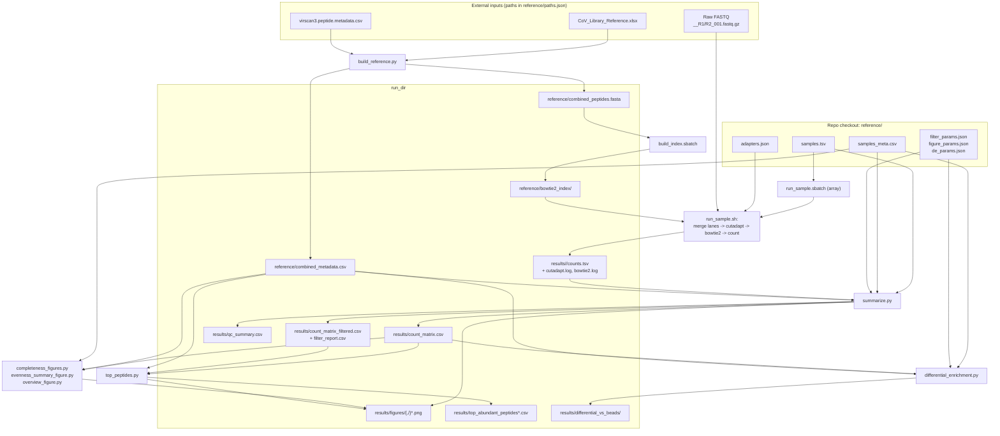

# PhIP-seq Phage Library QC and Enrichment Pipeline

## Overview

This repository processes T7 phage-display (PhIP-seq) sequencing data on a
SLURM-scheduled HPC cluster. Starting from raw paired-end FASTQ, it:

1. builds a combined peptide reference from two in-house phage libraries
   ("T7CoV" and "T7 Vir3.2/VirScan3");
2. trims, aligns and counts reads per designed peptide, one SLURM array
   task per sample;
3. aggregates counts into a peptide × sample matrix and produces **library
   QC** (coverage, dropouts, evenness, cross-library mapping, replicate
   correlation, PCA, top peptides);
4. runs **differential enrichment** (DESeq2-style, via PyDESeq2) of each
   immunoprecipitation (IP) treatment against the input/background library.

The pipeline began as a QC tool for naive (pre-selection) library batches
(`TC_1`–`TC_6`). It is now configured for the **PhIP_Seq1 run**:

- **31 samples** (`PhIP_Seq1_5` … `PhIP_Seq1_36`), all on the **Vir3**
  library, from one sequencing lane (`L006`).
- Two IP experiments: **IP4** (13 samples, 7 treatments) and **IP5**
  (18 samples, 9 treatments), each with 2 replicates per treatment.
- Each IP includes a `Vir3 only` input-library sample and a
  `Phage & beads` mock IP. The mock IP is the reference for differential
  enrichment.
- `PhIP_Seq1_18` (IP4, `Serum 2%`) has a row in `samples_meta.csv` but no
  FASTQ, so it is left out of `samples.tsv`. IP4 `Serum 2%` therefore has
  only one replicate.

**The repo checkout and the run output are separate directories.** All
generated reference data (`combined_peptides.fasta`, `combined_metadata.csv`,
the bowtie2 index) and all `results/` output are written to a `run_dir` set
in `reference/paths.json`. Only hand-maintained config, scripts and sample
sheets live in the repo. For this run, `run_dir` is
`/nemo/stp/babs/working/bootj/projects/bauerd/tiphaine.cayol/phipseq_lib2`.

**`results/` inside the repo is legacy.** It holds output from the old
pre-SLURM, single-end, per-lane pipeline for `TC_1`–`TC_4`. Examples are
`R1_counts.tsv`/`R2_counts.tsv` and `count_matrix_R1.csv`/`_R2.csv`.
No current script reads or writes it. [slurm_plan.md](slurm_plan.md)
records the design rationale for the migration: lane merging, paired-end
alignment, JSON config, retired scripts and resource requests.

### Reading the code

Every script is commented line by line for an intermediate Python
programmer. Each function opens with a short block saying what goes in,
what comes out and who calls it. Comments next to the code cover the
pandas/numpy/matplotlib idioms and the statistics: CPM, Gini, Lorenz,
Shannon entropy, Hurlbert rarefaction, PCA, DESeq2. The shell scripts
explain each bash idiom and each `cutadapt`/`bowtie2`/`samtools` flag.

## Quick start

Run from the repo root. **Before submitting any `.sbatch` script**, export
the repo path once per shell session:

```bash
export PHIPSEQ_REPO_DIR=/path/to/PhIPseq
```

SLURM copies a submitted script to a spool directory on the compute node
and runs that copy, so the script cannot locate the repo from its own path
(`${BASH_SOURCE[0]}`). All four `.sbatch` scripts fail immediately with a
clear message if `PHIPSEQ_REPO_DIR` is unset.

1. **Build the conda env** (once, and again whenever `environment.yml`
   changes):
   ```bash
   bash scripts/setup_env.sh
   ```
2. **Check `reference/paths.json`**: FASTQ directory, CoV `.xlsx` and Vir3
   `.csv` source files, and `run_dir`. It currently points at the
   PhIP_Seq1 run.
3. **Check the sample sheets**: `reference/samples.tsv` (which samples to
   run) and `reference/samples_meta.csv` (`ip`/`treatment` for each sample).
4. **Build the combined reference**:
   ```bash
   conda activate phipseq
   python scripts/build_reference.py
   ```
   → `<run_dir>/reference/combined_peptides.fasta`, `combined_metadata.csv`
5. **Build the bowtie2 index**:
   ```bash
   sbatch scripts/build_index.sbatch
   ```
   → `<run_dir>/reference/bowtie2_index/combined.*`
6. **Check `reference/adapters.json`**. It is hand-maintained; no script
   generates it.
7. **Trim, align and count all samples**: an array job with one task per
   data row of `samples.tsv`.
   ```bash
   sbatch scripts/run_sample.sbatch
   ```
   The script requests `--array=1-29`. Pass `--array=<first>-<last>` to run
   a different set of rows, e.g. to re-run individual samples.
8. **Aggregate, QC figures and top-peptide tables**, after all array tasks
   succeed:
   ```bash
   sbatch --dependency=afterok:<run_sample_job_id> scripts/summarize.sbatch
   ```
   This runs `summarize.py`, `completeness_figures.py`,
   `evenness_summary_figure.py`, `overview_figure.py` and
   `top_peptides.py`, in that order. `summarize.py` stops with an error
   listing every sample whose `counts.tsv` is missing or empty.
9. **Differential enrichment**, after summarize:
   ```bash
   sbatch --dependency=afterok:<summarize_job_id> scripts/differential.sbatch
   ```

For a single sample without SLURM, run `run_sample.sh` directly. This needs
`cutadapt`, `bowtie2` and `samtools` on `PATH` and a `python3`. It does not
need `PHIPSEQ_REPO_DIR`, because plain bash can resolve the script's own
path.

```bash
bash scripts/run_sample.sh PhIP_Seq1_5 Vir3 CAY9116A13_S4 [subsample_reads]
```

None of the `.sbatch` scripts set `--output`, so SLURM writes
`slurm-<jobid>.out` to whatever directory you submit from. Pass
`--output=<run_dir>/logs/%x-%j.out` to keep these logs out of the repo
checkout. Create `logs/` first, because SLURM will not.

## Repository structure

```
PhIPseq/
├── environment.yml                 # conda env spec (Python packages only)
├── slurm_plan.md                   # SLURM/HPC migration design notes
├── scripts/
│   ├── setup_env.sh                # build/update the "phipseq" conda env
│   ├── build_reference.py          # source library files -> combined FASTA + metadata (in run_dir)
│   ├── build_index.sbatch          # SLURM: bowtie2-build the combined index (in run_dir)
│   ├── run_sample.sh               # one sample: merge lanes -> cutadapt -> bowtie2 -> counts.tsv
│   ├── run_sample.sbatch           # SLURM array wrapper around run_sample.sh
│   ├── summarize.sbatch            # SLURM: summarize.py + the four figure/table scripts
│   ├── summarize.py                # count matrix, filtered matrix, qc_summary.csv, core figures
│   ├── completeness_figures.py     # coverage bars, rarefaction curves, detection histograms
│   ├── evenness_summary_figure.py  # per-sample evenness (P10-P90 range, near-dropouts)
│   ├── overview_figure.py          # coverage + evenness stacked overview
│   ├── top_peptides.py             # top-variable heatmap, top-abundant tables (+ helpers reused by DE)
│   ├── differential.sbatch         # SLURM: differential_enrichment.py
│   ├── differential_enrichment.py  # PyDESeq2 enrichment vs background, per IP x treatment
│   ├── sample_groups.py            # shared: sample sheet + metadata, colours, figure groups
│   └── count_filters.py            # shared: coverage threshold + count-matrix row filter
├── reference/                      # hand-maintained config, tracked in git
│   ├── paths.json                  # FASTQ dir, source library files, run_dir
│   ├── run_params.json             # lanes, bowtie2/cutadapt thread counts
│   ├── adapters.json               # per-library R1/R2 constant adapter sequences
│   ├── build_reference_params.json # vector anchor sequences, min Vir3 insert length
│   ├── filter_params.json          # low-count filtering thresholds
│   ├── figure_params.json          # figure tunables (+ optional treatment_colors)
│   ├── de_params.json              # differential enrichment settings
│   ├── hpc_modules.json            # pinned HPC module versions (documentation; not read by scripts)
│   ├── samples.tsv                 # sample sheet: tc_id, library, sample_prefix
│   ├── samples_meta.csv            # sample metadata: sample, ip, treatment
│   └── combined_metadata.csv       # legacy copy from the pre-migration pipeline (scripts use run_dir's)
├── results/                        # LEGACY pre-migration output (TC_1-TC_4); not used
└── .gitignore
```

And in `run_dir` (not part of the repo):

```
<run_dir>/
├── reference/
│   ├── combined_peptides.fasta       # build_reference.py
│   ├── combined_metadata.csv         # build_reference.py
│   └── bowtie2_index/combined.*      # build_index.sbatch
└── results/
    ├── <tc_id>/                      # counts.tsv, cutadapt.log, bowtie2.log  (run_sample.sh)
    ├── count_matrix.csv              # summarize.py
    ├── count_matrix_filtered.csv     # summarize.py
    ├── filter_report.csv             # summarize.py
    ├── qc_summary.csv                # summarize.py
    ├── top_abundant_peptides.csv     # top_peptides.py
    ├── top_abundant_peptides_wide.csv
    ├── figures/                      # all-sample figures + pca_scores.csv
    │   └── <ip>/                     # same file names, one folder per IP (IP4/, IP5/)
    ├── differential/                 # earlier run vs "Vir3 only" (kept for comparison)
    └── differential_vs_beads/        # differential_enrichment.py (current: vs "Phage & beads")
        ├── differential_results.csv, enrichment_summary.csv, organism_summary.csv
        └── <ip>/                     # per-contrast CSVs, size_factors.csv, figures
            └── top_hits/             # normalised counts of each contrast's top 10 hits
```

## Environment & dependencies

**Python**: `environment.yml` defines the conda env `phipseq` (built with
`scripts/setup_env.sh`; conda-forge):

| Package | Used for |
|---|---|
| `python` (unpinned) | everything |
| `pandas>=2.2`, `numpy>=2.1` | all Python scripts |
| `matplotlib>=3.9` | all figures (`Agg` backend, no display needed) |
| `scipy>=1.14` | `gammaln`/`binom` (rarefaction), hierarchical clustering (heatmaps) |
| `openpyxl>=3.1` | `pandas.read_excel` engine for the CoV `.xlsx` (`build_reference.py`) |
| `pydeseq2>=0.5` | differential enrichment (`differential_enrichment.py`) |

The env currently resolves Python 3.14 and pandas 3.x.

**Command-line tools** come from the HPC module system, not conda. Only
`run_sample.sbatch` and `build_index.sbatch` load modules;
`summarize.sbatch` and `differential.sbatch` only activate the conda env.

| Tool | Module | Used in |
|---|---|---|
| `cutadapt` | `cutadapt/4.2-GCCcore-11.3.0` | `run_sample.sh` (paired trimming) |
| `bowtie2`, `bowtie2-build` | `Bowtie2/2.5.4-GCC-14.2.0` | `run_sample.sh`, `build_index.sbatch` |
| `samtools` | `SAMtools/1.22.1-GCC-14.2.0` | `run_sample.sh` (read filtering) |

`reference/hpc_modules.json` records these versions, but no script reads
it. Keep it in sync with the `module load` lines by hand. `zcat`, `gzip`,
`sort`, `uniq` and `awk` are standard system tools.

## Configuration

All paths, tunables and library-design constants live in JSON or sheets
under `reference/` in the repo checkout. Every Python script finds them via
`Path(__file__).resolve().parent.parent`, then resolves `run_dir` from
`paths.json`. The repo and `run_dir` can therefore be unrelated
directories.

| File | Keys | Read by |
|---|---|---|
| `paths.json` | `fastq_dir`, `cov_xlsx`, `vir3_csv`, `run_dir` | every script |
| `run_params.json` | `lanes` (currently `["L006"]`), `bowtie_threads`, `cutadapt_threads` | `run_sample.sh` |
| `adapters.json` | `CoV`/`Vir3` → `R1`/`R2` adapter (cutadapt `-g`/`-G`) | `run_sample.sh` |
| `build_reference_params.json` | `cov_anchor_5/3`, `vir3_anchor_5/3`, `min_vir3_insert_len` | `build_reference.py` |
| `filter_params.json` | `coverage_min_count`, `matrix_filter_min_count`, `matrix_filter_min_samples` (all via `count_filters.py`) | summarize, completeness, overview, top_peptides, differential |
| `figure_params.json` | `outlier_threshold`, `legend_bbox_anchor`, `xtick_rotation`, `heatmap_tick_fontsize`, `detection_histogram_ncols`, `pca_n_top_variable_peptides`, `heatmap_n_top_variable_peptides`, `top_abundant_n_peptides`, optional `treatment_colors` | summarize, completeness, evenness, overview, top_peptides, `sample_groups.py` |
| `de_params.json` | `reference_treatment`, `mock_treatment` (null = off), `output_dir`, `alpha`, `lfc_threshold`, `size_factors_fit_type`, `shrink_lfc`, `low_count_max`, `n_label_top`, `heatmap_max_peptides`, `organism_plot_max_organisms` | `differential_enrichment.py` |
| `hpc_modules.json` | module names | nobody (documentation) |
| `samples.tsv` | `tc_id`, `library` (`CoV`/`Vir3`), `sample_prefix` (FASTQ name stem) | `run_sample.sbatch`; all Python aggregation scripts |
| `samples_meta.csv` | `sample` (= `tc_id`), `ip`, `treatment` | all Python aggregation scripts (via `sample_groups.py`) |

**Sample sheets.** All six aggregation scripts (`summarize`,
`completeness_figures`, `evenness_summary_figure`, `overview_figure`,
`top_peptides`, `differential_enrichment`) load them through
`sample_groups.load_samples()`.

- Two optional positional CLI arguments override the defaults: the first
  is the sample sheet, the second the metadata. This is handy for running
  on a subset of samples. `run_sample.sbatch` always uses
  `reference/samples.tsv`.
- Every `samples.tsv` sample must have an `ip` and a `treatment`, or the
  script exits naming the missing ones.
- Metadata rows for samples not in `samples.tsv` are ignored for plotting.
  Their treatments still take a colour, and a blank `treatment` in any row
  is an error.

### Low-count filtering

`scripts/count_filters.py` applies two deliberately separate filters:

- **Coverage threshold (`coverage_min_count`, 10).** For completeness
  metrics, a peptide counts as detected only with ≥ 10 reads.
  - This is always reported *alongside* the ≥ 1-read metrics, never
    instead of them:
    - the `n_peptides_detected_min10`/`pct_library_covered_min10` columns
      in `qc_summary.csv`;
    - solid (≥ 10) over pale (≥ 1) bars in `coverage_bar.png` and
      `overview_all_samples.png`;
    - `rarefaction_curves_min10.png`, using a binomial-thinning
      approximation;
    - a shaded 1–9-read band in `detection_histogram.png`.
  - The count matrix is unchanged, and the denominator is always the full
    designed library.
- **Matrix filter (≥ `matrix_filter_min_count` reads in ≥
  `matrix_filter_min_samples` samples, i.e. 10 in 2).** Whole peptides
  (rows) that fail it are dropped, so no NAs are introduced.
  `min_samples = 2` matches the replicate count, so a peptide seen
  consistently in one treatment's replicates is kept without needing group
  labels.
  - **Across all samples**, `summarize.py` writes the result as
    `count_matrix_filtered.csv`, with per-sample reads removed in
    `filter_report.csv`. `top_peptides.py` uses it for the top-abundant
    tables; their CPM still divides by each sample's raw own-library total.
  - **Within each figure group**, the between-sample figures (PCA, batch
    correlation, top-variable heatmap) re-apply the same thresholds to only
    that group's samples (`passes_filter`). For example, the IP4 figures
    use only peptides with ≥ 10 reads in ≥ 2 IP4 samples (~74,900), not
    peptides kept because of IP5.
  - **Within each contrast**, `differential_enrichment.py` applies the same
    thresholds to only the treatment and reference samples.
  - It is **never** used for coverage: the dropped rows are by definition
    the undetected ones, so coverage over the kept rows would be inflated.
- Rank-abundance, Lorenz, Shannon entropy and evenness use the raw matrix.
  Evenness already calls out ≤ `outlier_threshold`-read peptides
  explicitly.
- Both `outlier_threshold` (≤ 10) and `coverage_min_count` (≥ 10) include
  exactly 10 reads. Such a peptide is a "near-dropout" in the evenness
  figures and also "detected at ≥ 10" in the coverage figures.

### Figure groups and colouring

`scripts/sample_groups.py` is imported by all six aggregation scripts. Its
figure-group logic is used by the five QC scripts, since
`differential_enrichment.py` does its own per-IP loop.

- **Groups.** Each QC figure is drawn once for all samples
  (`results/figures/`) and once per IP (`results/figures/<ip>/`), with the
  same file names and the group in the title. `figure_groups()` creates
  the per-IP folders.
- **Colour = treatment**, fixed across every figure and group so IP4 and
  IP5 are directly comparable. Colours come from `tab20` in order of first
  appearance in `samples_meta.csv`, with optional overrides from
  `figure_params.json`'s `treatment_colors`. More than 20 treatments would
  wrap and reuse colours.
- **Line style / marker** applies to the line and scatter figures
  (rank-abundance, Lorenz, rarefaction, PCA). It encodes **ip** in
  the all-samples figures and **replicate** in the per-IP figures.
  Replicates are numbered 1, 2, … within ip + treatment, in `samples.tsv`
  order. In the all-samples figures, tick labels are prefixed with the ip.
- **Sample order** is by ip, then treatment (`samples_meta.csv` order),
  then `samples.tsv` order, so replicates sit side by side. This is also
  the column order of `count_matrix.csv` and the row order of
  `qc_summary.csv`. Sorting is by plain string, so `IP10` would sort before
  `IP4`.
- Near-dropout markers are black and the "never detected" histogram bin is
  dim grey, to stay distinct from the treatment palette.
- **PCA** is computed separately for each group: log10(CPM + 1) of the
  group's samples, where CPM divides by each sample's raw own-library read
  total.
  - It uses peptides passing the matrix filter within that group, then the
    top `pca_n_top_variable_peptides` (5,000) by variance.
  - Each plot has its own axes, so positions are not comparable between
    groups. Scores (PC1–PC5) go to `pca_scores.csv` in each figures folder.
  - PCA is skipped, with a stderr message, if samples span several
    libraries, or if a group has fewer than 3 samples or fewer than 2
    passing peptides.

### Differential enrichment

`scripts/differential_enrichment.py` (run by `differential.sbatch`) tests
which peptides are enriched over the **`Phage & beads` mock IP**,
**separately within each IP**. Settings live in `reference/de_params.json`.
Results go to `results/differential_vs_beads/`.

- **Why the mock IP is the comparator.** The mock IP goes through every
  step except the antibody, so comparing against it removes phage that bind
  the beads or plastic. This is the standard PhIP-seq design.
  - An earlier run compared against the `Vir3 only` input library. Its
    results are kept in `results/differential/` for comparison.
  - To rerun that way, set `reference_treatment: "Vir3 only"`,
    `mock_treatment: "Phage & beads"` and a different `output_dir`.
- **What changed versus the input-library comparison:**
  - **Bead binders drop out.** IP5 monoclonal-antibody hits fall from
    36–53 per contrast to 12–16.
  - **The recurring herpes signal was mostly bead binding.**
    - Before the switch, 17 peptides were enriched in 5 or more contrasts,
      9 of them herpes. Now 3 are, 1 of them herpes.
    - Herpes peptides now make up 18–21% of hits, the same as their share
      of the library (18%).
  - **The positive control holds.** 13 of the top 15 IP4 `12CA5 2ug` hits
    are influenza A hemagglutinin (175 HA peptides enriched in total).
- **Model.** There is one PyDESeq2 negative-binomial GLM fit per contrast:
  each non-reference treatment against `reference_treatment`
  (`Phage & beads`) within that IP.
  - This includes `Vir3 only` (input vs mock), kept as a QC contrast. In
    IP5 it gives 0 enriched and 25 depleted peptides, so the IP5 mock is
    almost identical to the input library. In IP4 it gives 1,265 enriched
    and 6,451 depleted, which is sampling noise from IP4's sparse samples.
  - The input is raw integer counts of own-library peptides; DESeq2 models
    counts, not CPM.
  - The test is a two-sided Wald test of LFC = 0, with Benjamini–Hochberg
    `padj` and DESeq2 independent filtering.
  - Peptides failing the per-contrast filter are kept in the output with
    `filtered=True` and NA statistics.
- **Calls.** **Enriched** means `padj < alpha` (0.05) and
  `log2FoldChange > lfc_threshold` (1). **Depleted** means `padj < alpha`
  and `log2FoldChange < -lfc_threshold`. The LFC cutoff is applied *after*
  testing against 0, so FDR is controlled for "LFC ≠ 0", not for
  "|LFC| > 1".
- **Why per contrast, not per IP.** Fitting all of an IP's samples in one
  model shares dispersion across more samples.
  - It also admits peptides absent from both reference samples, which pass
    the per-IP filter on other treatments.
  - Some of those hit PyDESeq2's optimiser bound, ±30/ln 2 = ±43.28 log2.
    This broke apeGLM shrinkage and pushed noise at 2–8 CPM to
    `padj ~1e-17`.
  - Fitting per contrast removes the bound-hitting estimates.
- **Peptides absent from the reference are tested, then flagged.**
  - A peptide with zero reads in both reference replicates is still tested
    whenever the treatment replicates pass the filter. Its true fold change
    is infinite, so the reported LFC (often 6–21) is only a lower bound.
  - These peptides are deliberately **not** pre-filtered out:
    - The strongest real hits are often absent from the background. For
      example, the 12CA5 HA peptide `Vir3|81117` has 0 reads in both input
      samples and 0 in one beads sample, against ~130,000 in each 12CA5
      sample.
    - A filter requiring presence in *both* groups uses the group labels,
      which breaks the independence that keeps DESeq2's p-values valid
      (Bourgon et al. 2010). The current filter is label-blind.
  - In IP4, most enriched calls are of this kind: 2,870 of 4,189 in
    `12CA5 2ug`, and 58–69% across the IP4 contrasts (except n = 1
    `Serum 2%`, which has none).
    - The root cause is sparse sampling of IP4's background. The beads
      samples detect only 36–44% of the library, against 85–99% in IP5.
    - In IP5, at most 7 hits per contrast are reference-absent.
- **Flags on enriched peptides.** These are added after testing; they never
  change the calls. Each is a column in the results and a count in
  `enrichment_summary.csv`:
  - `reference_absent`: 0 reads in every reference replicate. These are
    drawn as hollow circles and tagged `[ref 0]` in plot labels.
  - `low_count_hit`: mean DESeq2-normalised count in the treatment below
    `low_count_max` (50), so both sides are low (e.g. 1 → 5) and the call
    is probably sampling noise. Tagged `[low]`. The ≥ 10-reads pre-filter
    already removes most such peptides.
  - `mock_enriched` (**off now**): when the reference is *not* the mock
    IP, this marks hits also enriched in the same IP's `mock_treatment`
    contrast. It is switched off (`mock_treatment: null`, column absent)
    because the mock IP is the comparator.
  - `n_enriched_unflagged` in `enrichment_summary.csv` counts the enriched
    peptides with none of the active flags, i.e. the most trustworthy hits.
- **Size factors** use `poscounts`. The default median-of-ratios needs
  peptides counted in every sample, and only 47 peptides are non-zero in
  all 13 IP4 samples. Within a single 4-sample contrast, 1,198–3,925 are,
  so this rationale is weaker than it first appears, but `poscounts`
  remains a safe choice.
- **LFC shrinkage is off** (`shrink_lfc: false`). PyDESeq2's apeGLM was
  unstable here: for some peptides the shrunken value collapsed to ~0.3
  while the raw LFC was 13–14. Raw `log2FoldChange` is reported and
  plotted.
- **Cook's-distance outlier filtering** cannot run with 2 replicates (it
  needs ≥ 3).
- **Calibration check.** Under the null, `frac_p_below_alpha` (the
  fraction of raw p < alpha) should be near `alpha`.
  - Contrasts above `CALIBRATION_WARN_FRAC` (0.10) get
    `calibration_flag = True` in `enrichment_summary.csv`, a red volcano
    title, and a warning in the job log.
  - **All six IP4 contrasts are flagged (0.21–0.43)**, which is worse than
    against the input library (0.22–0.28). Their p-values are
    anti-conservative and their hit counts are upper bounds. This matches
    IP4's poor replicate correlation. Treat IP4 as exploratory.
  - IP5 contrasts sit at 0.012–0.033, i.e. well calibrated.
  - **IP4 `Serum 2%` has one replicate** (n = 1, flagged in the volcano).
    Against beads it gives 187 enriched peptides at 0.43 calibration, so
    treat them as unreliable.
- **Positive control.** IP4 `12CA5 2ug` is an antibody against the
  influenza HA tag (the 12CA5 epitope is HA residues 98–106). Its top hits
  are influenza A H3N2 hemagglutinin peptides: 13 of the top 15. This is
  the expected result, and checks that normalisation and the contrast
  setup are right.
- IPs with no reference-treatment samples are skipped. A run whose samples
  span more than one library exits with an error.

## Script running order

| Step | Script | Requires | Produces |
|---|---|---|---|
| 1 | `build_reference.py` | source `.xlsx`/`.csv` (`paths.json`) | `<run_dir>/reference/combined_peptides.fasta`, `combined_metadata.csv` |
| 2 | `build_index.sbatch` | step 1 FASTA | `<run_dir>/reference/bowtie2_index/combined.*` |
| 3 | `run_sample.sbatch` → `run_sample.sh` (array) | step 2 index, `adapters.json`, FASTQ | `<run_dir>/results/<tc_id>/{counts.tsv,cutadapt.log,bowtie2.log}` |
| 4 | `summarize.py` | step 3 for every sample, step 1 metadata | `count_matrix.csv`, `count_matrix_filtered.csv`, `filter_report.csv`, `qc_summary.csv`, core figures |
| 5 | `completeness_figures.py`, `evenness_summary_figure.py`, `overview_figure.py`, `top_peptides.py` | step 4 (`count_matrix.csv`; `top_peptides.py` also needs `count_matrix_filtered.csv`) | remaining figures and top-peptide tables |
| 6 | `differential_enrichment.py` (`differential.sbatch`) | step 4 `count_matrix.csv` | `results/differential_vs_beads/` (`output_dir`) |

Steps 4–5 run sequentially in `summarize.sbatch`; the four step-5 scripts
do not depend on each other. Samples in step 3 are independent and run
concurrently.

## How it fits together / data flow



## Shared inputs/outputs

- **`reference/paths.json`** is read by every script to resolve `run_dir`.
  It is the one place where the repo/run_dir split is configured.
- **`reference/samples.tsv`** is read by `run_sample.sbatch` (always this
  file) and by all six Python aggregation scripts (overridable as CLI
  argument 1).
- **`reference/samples_meta.csv`** is read by all six Python aggregation
  scripts via `sample_groups.py` (overridable as CLI argument 2).
- **`reference/adapters.json`** is read only by `run_sample.sh`.
- **`reference/filter_params.json`** is read via `count_filters.py` by
  summarize, completeness, overview, top_peptides and differential.
- **`reference/figure_params.json`** is read by the five QC scripts and by
  `sample_groups.py`.
- **`<run_dir>/reference/combined_metadata.csv`** is produced by
  `build_reference.py`. All six aggregation scripts read it to map
  `ref_id` → library/organism/protein.
- **`<run_dir>/reference/combined_peptides.fasta`** is produced by
  `build_reference.py` and read only by `build_index.sbatch`.
- **`<run_dir>/reference/bowtie2_index/combined`** is produced by
  `build_index.sbatch` and read only by `run_sample.sh`.
- **`<run_dir>/results/<tc_id>/counts.tsv`, `cutadapt.log`,
  `bowtie2.log`** are produced by `run_sample.sh` and read only by
  `summarize.py`.
- **`<run_dir>/results/count_matrix.csv`** is produced by `summarize.py`
  and read by completeness, evenness, overview, top_peptides and
  differential.
- **`<run_dir>/results/count_matrix_filtered.csv`** is produced by
  `summarize.py` and read by `top_peptides.py`.
- **`top_peptides.py` functions** `draw_peptide_heatmap`, `peptide_label`
  and `short_name` are imported by `differential_enrichment.py`. Changing
  them also changes the DE heatmap and labels.

## Reference data

There is no public genome or annotation. The "reference" is the combined
set of designed phage-display peptide inserts (nucleotide sequences) from
two source libraries:

- **T7CoV** (`library = CoV`, 6,932 peptides): SARS-CoV-2 and related
  coronavirus 56-mer tiles, from `CoV_Library_Reference.xlsx`.
  - `source_id` is the per-clone barcode ID.
  - `parent_peptide_id` groups synonymous barcode replicates
    (`BC1`/`BC2`/…).
  - The insert is the sequence between fixed 5'/3' vector anchors.
- **T7 Vir3.2 / VirScan3** (`library = Vir3`, 115,753 peptides): pan-viral
  tiles, from `virscan3.peptide.metadata.csv`.
  - This file combines three provenances sharing one oligo pool: `Vir2`,
    `Vir3` and `IEDB`.
  - `Vir2` oligos mark the insert in lowercase, so the insert is taken as
    the longest lowercase `[acgt]` run.
  - `Vir3`/`IEDB` oligos are uppercased, then the insert is taken between
    the fixed anchors.
  - Inserts shorter than `min_vir3_insert_len` (15 nt) are dropped. Exact
    duplicate rows are collapsed; other `id` collisions get a `.dupN`
    suffix.
- IDs are namespaced as `CoV|<id>` / `Vir3|<id>`. The combined reference
  has 122,685 peptides.
- `combined_metadata.csv` columns: `ref_id`, `library`, `source_id`,
  `parent_peptide_id`, `organism`, `protein_name`, `peptide_aa`, `start`,
  `end`, `insert_len`. `organism` and `protein_name` are carried through
  from the source files as-is.

Both libraries are aligned against together. `pct_mapped_to_other_library`
in `qc_summary.csv` is therefore a cross-library contamination or
mislabelling check.

## Compute requirements

| Job | CPUs | Memory | Wall-clock | Notes |
|---|---|---|---|---|
| `build_index.sbatch` | 4 | 8G | 1 h | One-off `bowtie2-build`. |
| `run_sample.sbatch` | 4 | 32G | 7 days | Array, one task per sample, unthrottled. `cutadapt -j2` then `bowtie2 -p4` run sequentially, so 4 CPUs covers the peak. The 7-day limit is requested flat (negligible queue cost on this cluster). The temp dir holds merged and trimmed FASTQ (several GB per sample) in `$TMPDIR`. |
| `summarize.sbatch` | 1 | 8G | 2 h | Five Python scripts, sequentially. |
| `differential.sbatch` | 8 | 32G | 4 h | PyDESeq2 fits ~10⁴–10⁵ peptide GLMs per contrast and parallelises over `SLURM_CPUS_PER_TASK`. |

There is no retry loop. A failed array task shows as a non-zero exit in
`sacct`/`seff`; resubmit it with `sbatch --array=<task_id> …`.

## Individual script details

### setup_env.sh
- Runs `conda env create -f environment.yml -n phipseq`, and falls back to
  `conda env update` if that fails.
- The fallback also triggers on solver errors, so read the output if the
  create step fails.

### build_reference.py
- **Purpose:** parse the two source library files into one FASTA and one
  metadata CSV with namespaced IDs.
- **Inputs:**
  - `paths.json` (`cov_xlsx`, `vir3_csv`, `run_dir`) and
    `build_reference_params.json`.
  - CoV `.xlsx` columns `Nucleotide sequence`, `Barcode ID`, `Peptide ID`,
    `Organsim` [sic], `Protein name`, `Peptide sequence`,
    `Start position`, `End position`.
  - Vir3 `.csv` columns `oligo`, `source`, `id`, `Organism`,
    `Protein.names`, `peptide`, `start`, `end`. This file is read as UTF-8
    with `errors="replace"`.
- **Outputs:** `<run_dir>/reference/combined_peptides.fasta` (nucleotide
  inserts) and `combined_metadata.csv`.
- **Steps:**
  1. CoV inserts: the sequence between the 5' anchor and the *last*
     occurrence of the 3' anchor (`rfind`), uppercased. Rows missing an
     anchor or with an empty insert are skipped and counted. The anchor
     search is case-sensitive.
  2. Vir3 inserts: the lowercase-run rule for `Vir2`, the anchor rule for
     `Vir3`/`IEDB`.
  3. The minimum length applies to all Vir3-file rows.
  4. Exact duplicates are collapsed. Other `id` collisions get `.dupN`,
     where N is a file-wide counter.
  5. CoV and Vir3 records are concatenated, and any `ref_id` duplicates are
     de-duplicated, keeping the first with a warning.
  6. Skip and duplicate counts are logged to stderr.
- **CLI:** none.

### build_index.sbatch
- Resolves `PROJECT_DIR` from `PHIPSEQ_REPO_DIR`, and `RUN_DIR` from
  `paths.json` using a system `python3 -c` one-liner (no conda needed).
- Loads the Bowtie2 module and runs
  `bowtie2-build --threads $SLURM_CPUS_PER_TASK` on the combined FASTA.
- Output: `<run_dir>/reference/bowtie2_index/combined.*`.

### run_sample.sh
- **Purpose:** trim, align and count one sample's paired-end reads.
- **Arguments:** `tc_id`, `library` (`CoV`|`Vir3`), `sample_prefix`,
  optional `subsample_reads` (default 0 = all reads).
- **Config:** one inline `python3` heredoc reads `paths.json`,
  `run_params.json` and `adapters.json`. It prints shell assignments
  (`FASTQ_DIR`, `RUN_DIR`, thread counts, `LANES` array, `R1/R2_ADAPTER`)
  that are `eval`'d.
- **Steps:**
  1. Create a fresh temp dir with `mktemp -d` (honours `$TMPDIR`). It is
     removed on exit by `trap`.
  2. **Merge lanes per mate.** `cat` the lane `.fastq.gz` files together;
     concatenated gzip is still valid gzip. With subsampling it uses
     `zcat | head -n 4N | gzip` instead. Only one lane (`L006`) is
     currently configured, so the merge is a copy.
  3. **Trim.** One paired `cutadapt` call: `-g` R1 adapter, `-G` R2
     adapter, `--discard-untrimmed`. A pair is dropped if either mate lacks
     its adapter (`--pair-filter=any`, the default). Output goes to temp
     files because paired bowtie2 needs two inputs.
  4. **Align and count.**
     - `bowtie2 -1/-2 --no-unal` streams SAM to
       `samtools view -F 4 -f 64`, which keeps mapped records that are
       mate 1. This gives one record per fragment whose mate 1 aligned,
       whether the pair was concordant, discordant or mate-1-only.
     - Then `cut -f3 | sort | uniq -c | awk` gives
       `ref_id<TAB>count`.
- **Outputs:** `<run_dir>/results/<tc_id>/counts.tsv`, `cutadapt.log`,
  `bowtie2.log`.

### run_sample.sbatch
- An array job: task *i* reads line *i + 1* of `samples.tsv` (skipping the
  header) and calls `run_sample.sh <tc_id> <library> <sample_prefix>`.
- Loads the Bowtie2, cutadapt and SAMtools modules, then activates
  `phipseq`, which provides `python3` for the config step.
- It requests `--array=1-29`. Pass `--array=...` at submission to run
  other rows, e.g. to re-run individual samples.

### summarize.sbatch
- Activates `phipseq`, then runs `summarize.py`, `completeness_figures.py`,
  `evenness_summary_figure.py`, `overview_figure.py` and `top_peptides.py`
  in order.
- With `set -e`, any failure stops the remaining scripts.

### summarize.py
- **Purpose:** build the count matrix and the core QC report.
- **Inputs:** the sample sheet and metadata (CLI arguments 1 and 2),
  `combined_metadata.csv`, each sample's `counts.tsv`/`cutadapt.log`/
  `bowtie2.log`, `filter_params.json` and `figure_params.json`.
- **Steps:**
  1. **Count matrix.** Rows are every designed `ref_id`, columns are
     samples in figure order, and missing counts are 0. Write
     `count_matrix.csv`.
  2. **Matrix filter** across all samples. Write
     `count_matrix_filtered.csv` and `filter_report.csv`, and print
     per-library peptides kept/removed to stderr.
  3. **Read statistics.** Parse the paired-mode cutadapt and bowtie2 logs:
     `raw_read_pairs`, `trim_rate`, `concordant_map_rate`,
     `concordant_multimap_rate`, `overall_map_rate`.
  4. **Per-sample QC**, written to `qc_summary.csv`. Columns ending in
     `_rate`, `pct_mapped_to_other_library` and `pct_library_covered*` are
     fractions (0–1), not percentages.
     - `pct_mapped_to_other_library`;
     - `n_designed_peptides`;
     - `n_peptides_detected`/`pct_library_covered` (≥ 1 read) and the
       `_min10` versions;
     - `n_dropouts`;
     - `median_count_detected`;
     - `gini_own_library`;
     - `shannon_entropy` and `normalized_shannon_entropy` (H / log2 of the
       designed library size).
  5. **Figures per group** (all samples and each IP):
     - `rank_abundance.png`;
     - `lorenz_curves.png`;
     - `batch_correlation_<library>.png`: Pearson r of log1p counts over
       group-filtered peptides, with treatment colour strips. The colour
       scale is clipped at 0, so negative r shows as 0;
     - `shannon_entropy.png`;
     - `pca_samples.png` and `pca_scores.csv` (see
       [Figure groups](#figure-groups-and-colouring)).
- **Failure modes:**
  - **A missing or empty `counts.tsv` is an error.** Before building the
    matrix, the script checks every sample and exits listing all missing
    or empty files. `summarize.sbatch` then stops before the figure
    scripts.
  - A missing `cutadapt.log`/`bowtie2.log` prints a warning and leaves
    that sample's read statistics blank.
  - A truncated log raises `AttributeError`.

### completeness_figures.py
- **Inputs:** sample sheets, `combined_metadata.csv`, `count_matrix.csv`,
  `filter_params.json` (`coverage_min_count`) and `figure_params.json`
  (`xtick_rotation`, `detection_histogram_ncols`).
- **Outputs (per group):**
  - `coverage_bar.png`: % of own library detected, solid ≥ 10 reads over
    pale ≥ 1 read.
  - `rarefaction_curves.png`: expected peptides detected at subsampled
    depths. This uses Hurlbert's (1971) exact formula, computed in log
    space with `gammaln` to avoid overflow. A dashed line marks the full
    library size.
  - `rarefaction_curves_min10.png`: the same for ≥ 10 reads, using a
    binomial-thinning approximation (`scipy.stats.binom`).
  - `detection_histogram.png`: one panel per sample. A "never detected"
    bar plus a symlog histogram of per-peptide counts, with the 1–9-read
    band shaded. The panel title gives the missing/below-threshold counts.

### evenness_summary_figure.py
- **Inputs:** sample sheets, `combined_metadata.csv`, `count_matrix.csv`,
  `figure_params.json` (`outlier_threshold`, `xtick_rotation`).
- **Output:** `evenness_summary.png` per group.
  - Each sample's detected own-library peptides are drawn as a P10–P90
    bar plus a median marker, on a log y axis.
  - Peptides with ≤ `outlier_threshold` reads are drawn individually as
    black "near-dropout" markers.
  - Tick labels carry near-dropout and missing (0-read) counts, or
    "(clean)" when both are zero.

### overview_figure.py
- **Inputs:** as for the evenness figure, plus `filter_params.json`
  (`coverage_min_count`).
- **Output:** `overview_all_samples.png` per group, with two stacked
  panels.
  - The top panel shows coverage as solid ≥ 10 over pale ≥ 1 bars,
    labelled with the ≥ 10 count. Its title gives the designed library
    size from the reference metadata (e.g. "115,753 designed (Vir3)"), one
    entry per library in the group.
  - The bottom panel is the evenness plot, with near-dropout and missing
    counts on its tick labels.
- The file name is the same in the per-IP folders, where it covers only
  that IP's samples.

### top_peptides.py
- **Inputs:**
  - sample sheets and `combined_metadata.csv`;
  - `count_matrix.csv` for the heatmap and `count_matrix_filtered.csv`
    for the tables;
  - `filter_params.json`;
  - `figure_params.json` (`heatmap_n_top_variable_peptides`,
    `top_abundant_n_peptides`, `heatmap_tick_fontsize`).
- **Normalisation:** CPM per sample, over its own library's raw total,
  because depth differs several-fold between samples. All samples must
  share one library.
- **Outputs:**
  - `top_variable_heatmap.png` per group: the top N (100) peptides by
    variance of log10(CPM + 1) within the group, among peptides passing
    the group's filter.
    - Rows are clustered (average linkage) and columns are in treatment
      order under a colour strip.
    - Rows are labelled `source_id | organism | protein start-end`, with
      names shortened.
  - `results/top_abundant_peptides.csv`: long format, one row per
    sample × rank (top 20). Columns: `tc_id`, `ip`, `treatment`, `rank`,
    `ref_id`, `peptide_label`, `read_pairs`, `cpm`,
    `fraction_of_sample_reads`, `organism`, `protein_name`, `start`/`end`,
    `peptide_aa`.
  - `results/top_abundant_peptides_wide.csv`: a rank × sample grid of
    labels, with column headers `<ip> <treatment> <tc_id>`.

### differential_enrichment.py
- **Method:** see [Differential enrichment](#differential-enrichment).
- **Inputs:** sample sheets, `combined_metadata.csv`, `count_matrix.csv`
  (raw counts), `de_params.json`, `filter_params.json`.
- **Outputs (under `<run_dir>/results/<output_dir>/`, currently `differential_vs_beads/`):**
  - `differential_results.csv`: every peptide × contrast. Columns: `ip`,
    `treatment`, `reference`, `n_treatment`/`n_reference`, `baseMean`,
    `log2FoldChange`, `lfcSE`, `stat`, `pvalue`, `padj`,
    `mean_cpm_treatment`/`_reference`, `mean_norm_treatment`/`_reference`
    (DESeq2-normalised), `filtered`, `enriched`, `depleted`, the flags
    `reference_absent`, `low_count_hit` (and `mock_enriched` when enabled), `ref_id`,
    `peptide_label`, plus annotation. The `*_shrunk` columns appear when
    `shrink_lfc` is on.
  - `<ip>/<treatment>_vs_<reference>.csv`: one contrast, sorted by `padj`.
    Treatment names are made filename-safe:
    - `%` → `pct`, `&` → `and`, `+` → `plus`, other symbols → `_`, so
      `Phage & beads` becomes `Phage_and_beads` and `Serum 2%` becomes
      `Serum_2pct`.
    - If two treatments would still get the same file name, the script
      stops at startup and names them.
  - `enrichment_summary.csv`: per contrast:
    - `n_tested`, `frac_p_below_alpha`, `calibration_flag`, `n_with_padj`,
      `n_enriched`, `n_depleted`;
    - the flag counts `n_enriched_reference_absent`,
      `n_enriched_low_count`, `n_enriched_mock` (when enabled), and
      `n_enriched_unflagged`;
    - the top hit with its LFC/padj.
  - `organism_summary.csv`: enriched-peptide counts per
    ip × treatment × organism.
  - `<ip>/size_factors.csv`.
  - `<ip>/` figures:
    - `volcano.png` and `ma_plots.png`:
      - the top `n_label_top` (10) enriched peptides by padj are labelled
        in a ranked column beside each panel, with flag tags;
      - `reference_absent` hits are hollow circles.
    - `pvalue_histograms.png`;
    - `dispersions.png`: gene-wise, trend and final;
    - `normalisation_boxplot.png`: per-sample distributions of raw and
      DESeq2-normalised log10(count + 1), with each sample's size factor.
      It uses peptides passing the filter within the IP, with size factors
      fitted over all the IP's samples (`poscounts`).
    - `top_hits/<treatment>_vs_<reference>_top10.png`: one panel per top-10
      hit. Each shows the DESeq2-normalised count of every reference and
      treatment replicate (the values the test compared), with the group
      means, LFC and padj.
    - `enriched_heatmap.png`: top enriched peptides across all of the IP's
      samples;
    - `enrichment_counts.png`;
    - `organism_enrichment.png`.
- **Threads:** `SLURM_CPUS_PER_TASK`.

### differential.sbatch
- Activates `phipseq` and runs `differential_enrichment.py`.
- Requests 8 CPUs, 32G and 4 h. It is separate from `summarize.sbatch`
  because the GLM fits are far heavier than the figure scripts.

## Known issues

These are findings from a code review that have not been fixed. They are
listed so readers know the current behaviour.

**Pipeline / shell**
- **Subsample mode aborts on real data.** Under `set -o pipefail`,
  `zcat … | head` kills `zcat` with SIGPIPE (exit 141), so
  `run_sample.sh … <N>` fails whenever the input has more than N reads.
  Full runs are unaffected.
- **A failed run can leave a partial `counts.tsv`**, because the alignment
  pipeline writes directly to it. A later `summarize` without a dependency
  will use it.
- **A config error in `run_sample.sh` surfaces late.** The `eval` of the
  Python config step returns 0 even if the Python fails, so the script
  stops only later, with an "unbound variable" error.

**Differential enrichment**
- **An IP whose only treatment is the reference crashes the script**
  (`pd.concat([])`).
- **Stale figures can remain after a rerun.** If an IP has no enriched
  peptides, its heatmap and organism plots are skipped, so files from an
  earlier run stay in place.
